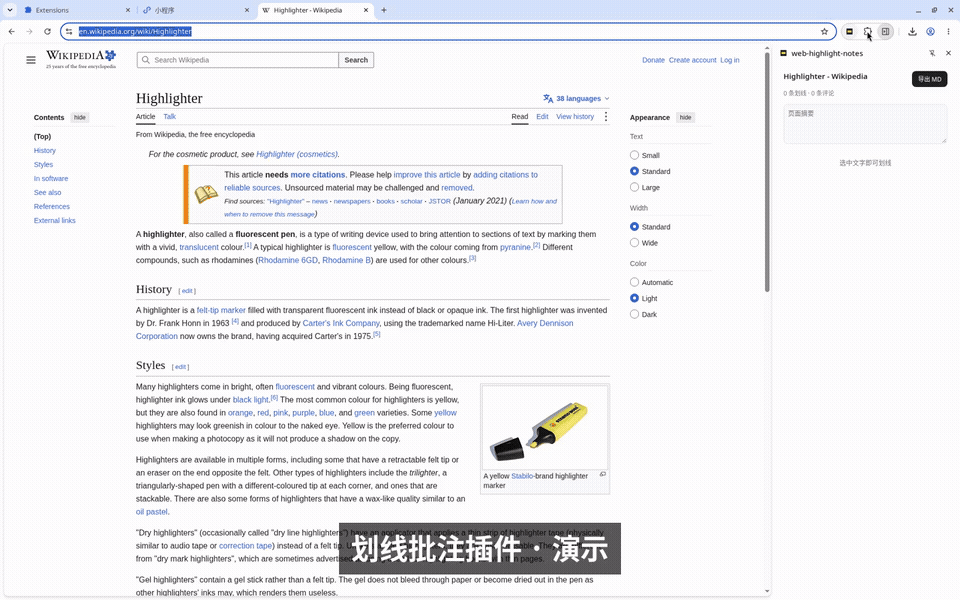

# web-highlight-notes

在网页上划线、写评论，并用 Chrome 侧边栏汇总、导出 Markdown 的扩展（Manifest V3，版本 0.1.4）。



完整使用手册见 [`docs/`](docs/index.html)（GitHub Pages 站点源文件）。

## 功能

- 选中网页文字后出现工具条，可以「划线」或「划线+评论」。输入框、文本域和 `contenteditable` 区域不会弹出工具条。
- 点击划线打开评论气泡，可以编辑评论或删除划线。⌘/Ctrl+Enter 保存，Esc 关闭。没保存的草稿会留下来，再次打开时恢复。
- 侧边栏顶部是页面摘要，输入时防抖保存，失焦或离开页面时立即落盘。下面是页面标题、「x 条划线 · y 条评论」和「导出 MD」。
- 划线按在页面中的顺序排列。点击一条会滚到对应位置并闪一下。
- 正文改了、找不到原句时，这条划线仍会保留，并标成「⚠ 未定位」，导出时也会带上。
- 「导出 MD」把笔记复制到剪贴板，同时下载 `.md` 文件。按钮会显示「已复制 ✓」约 1.5 秒。

- 界面跟随 Chrome 语言：中文（zh_CN）或英文（en），包括导出的 Markdown 标签。

## 权限（0.1.4 起）

安装时不申请任何网站权限，也不申请 `tabs`。

- 点击工具栏图标（或快捷键 Alt+Shift+H）：打开侧边栏，并通过 `activeTab` 在当前页启用划线、显示这一页已有的划线。
- 在某个网站第一次划线后，选中文字下方 8px 出现一张小卡片（下方放不下时移到上方，不遮挡选区和工具条）「允许在此网站自动显示划线，刷新后仍在」。点「允许」会弹出 Chrome 的授权框，只申请这个网站（例如 `https://example.com/*`）。允许后扩展为这个网站注册内容脚本，以后打开或刷新页面会自动显示划线。
- 点「暂不」或在授权框里拒绝：划线照样保存在本地，侧边栏照样列出、可以导出，只是刷新后不会自动显示，需要再点一次插件图标。侧边栏计数下方会提示「此网站需点击插件图标显示划线」，旁边的「去授权」可以随时补授权。拒绝后这个网站不会再弹卡片。
- 从 0.1.3 升级：Chrome 会保留 0.1.3 安装时给的全部网站权限，已有划线的网站继续自动显示，不需要重新授权。
- 本地文件（0.1.5 起）：申请 `file:///*`，不产生安装警告，也不弹授权卡片。Chrome 默认关闭扩展的「允许访问文件网址」；打开后本地 HTML 自动显示划线、刷新后仍在。关闭时 Chrome 不让扩展读本地文件的网址，侧边栏在点击插件图标后显示卡片「此页面暂时不能划线 / 如果是本地 HTML 文件，在扩展详情里打开“允许访问文件网址”即可」，「打开扩展设置」直达 `chrome://extensions/?id=<扩展 id>`。这时 about:blank、data:、blob: 页面和本地文件在扩展看来完全一样，所以文案两种情况都适用。
- `chrome://`、新标签页、Chrome 应用店等不允许扩展的页面，侧边栏显示「此页面不支持划线」。

笔记存在 `chrome.storage.local`，键是去掉 hash 的页面 URL。单页应用用 `history.pushState` 换地址时，划线跟着新地址走：旧地址的划线收起，新地址的划线（如果有）显示出来，侧边栏同步切换；只改 hash 不算换页。再次打开页面时，用原文加上前后约 30 个字重新定位，匹配可以跨过多个文本节点。

## 安装

先运行 `npm run build`，得到 `dist/web-highlight-notes-v0.1.4.zip`。

先解压 zip → 打开 chrome://extensions → 开启「开发者模式」 → 点击「加载已解压的扩展程序」选择解压后的目录。

然后点击工具栏图标，侧边栏会打开，当前页就可以划线。

## 使用

1. 打开普通网页，选中一段文字，点「划线」或「划线+评论」。
2. 在气泡里写评论。⌘/Ctrl+Enter 或「保存」会记下评论；Esc 只关闭气泡，草稿还在。
3. 打开侧边栏，写这一页的摘要。点列表里的划线可以跳回正文。
4. 点「导出 MD」。文件里包含标题、来源、摘要，以及每条划线和它的评论。

## 开发与测试

```bash
npm install
npm test
npx playwright install --with-deps chromium
xvfb-run npm run e2e
npm run build
```

- `npm test`：锚定（含重复文本消歧、原文改变后失败）、Markdown 导出、网站权限模式、中英文案键一致的单元测试。
- `npm run e2e`：Playwright 加载未打包扩展，对本地文章页跑端到端场景。需要图形界面；没有显示器时用 `xvfb-run`。工具栏图标和 Chrome 原生授权框 Playwright 点不到，测试用 `xdotool` 发真实按键：快捷键 Alt+Shift+H 等同点击图标（同样授予 activeTab），授权框里 Return 是「拒绝」、Tab Return 是「允许」。需要 `xdotool`（`sudo apt-get install -y xdotool`）。
- `npm run build`：生成 `dist/web-highlight-notes-v0.1.4.zip`，压缩包根目录就是 `manifest.json`。
